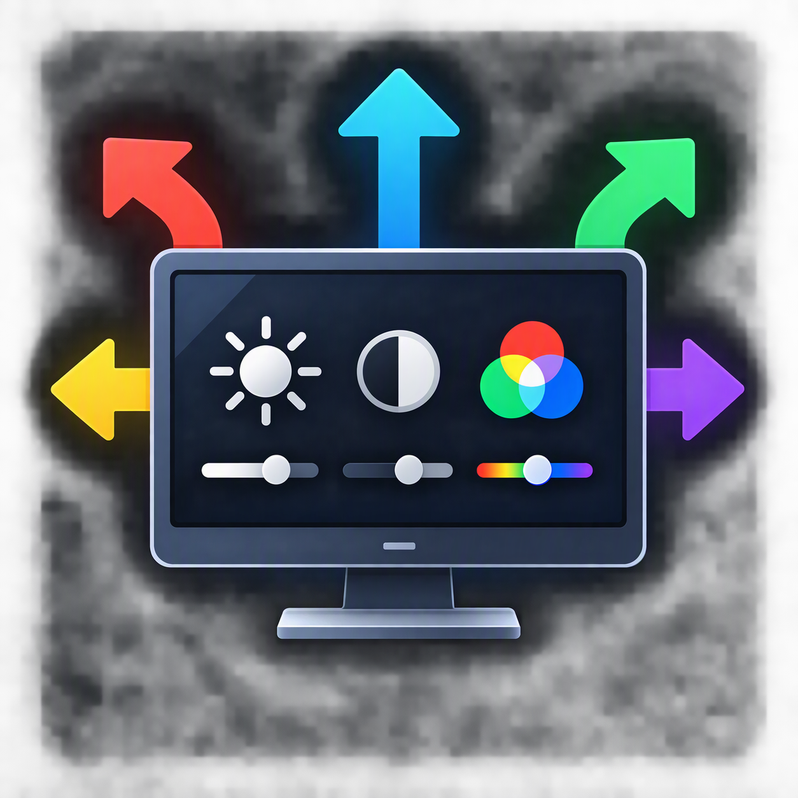
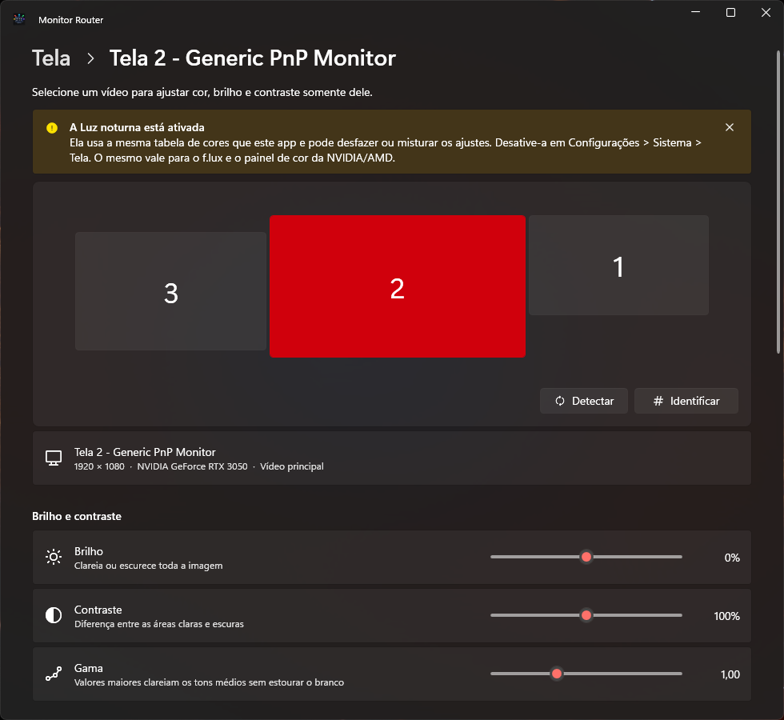
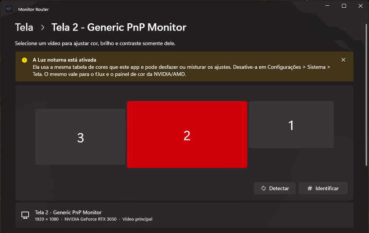
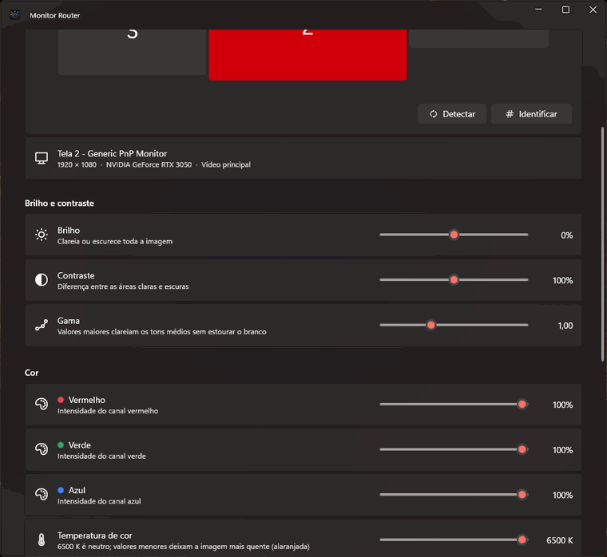
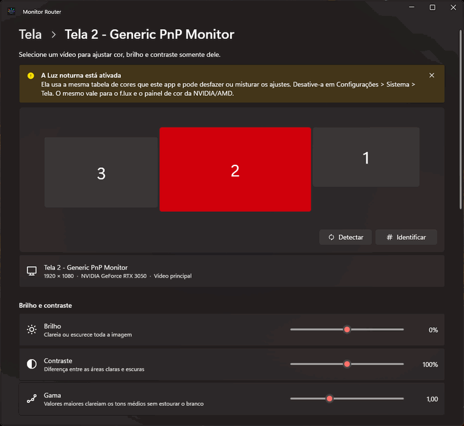

<p align="center">
  
</p>

# Monitor Router

Aplicativo para Windows 11 (C# / .NET 10 / WPF) que ajusta **brilho, contraste, gama, cor (R/G/B) e temperatura de cor de cada monitor ou TV de forma independente**, com visual Fluent (WPF-UI) no estilo das Configurações do Windows 11.

<p align="center">
  
</p>

## Veja em ação

### 1. Escolha o monitor no mapa

O mapa mostra os monitores na posição real, como em *Configurações > Sistema > Tela*. Clique em um deles e **todos os controles passam a valer só para ele**. O botão **Identificar** mostra o número grande em cada tela por 2 segundos.

<p align="center">
  
</p>

### 2. Ajuste em tempo real

Brilho, contraste, gama, vermelho, verde, azul e temperatura de cor. O ajuste é aplicado **enquanto você arrasta** o slider, e os valores ficam dentro de faixas seguras, porque o Windows recusa curvas muito extremas.

<p align="center">
  
</p>

> Os GIFs mostram a interface. A mudança de cor em si acontece na saída da placa de vídeo, depois da imagem que o Windows entrega ao capturador de tela, então ela só aparece no seu monitor de verdade.

### 3. Redefinir, copiar e perfis

Mais abaixo na janela: **Redefinir** (um monitor ou todos), **Copiar configuração** de um monitor para outro (ou para todos os outros), **Perfis** nomeados como "Jogo", "Leitura" ou "Noite", e a opção de iniciar com o Windows.

<p align="center">
  
</p>

## Como funciona

O app usa a **Gamma Ramp** da placa de vídeo: uma tabela de 256 entradas por canal (R, G, B), com valores de 0 a 65535, que o driver aplica ao sinal enviado ao monitor. Como o ajuste é feito no sinal da GPU, funciona em qualquer monitor ou TV ligado por HDMI/DisplayPort.

Para cada monitor, a tabela é calculada com:

```
v = i/255
v = (v - 0.5) * contraste + 0.5 + brilho
v = clamp(v, 0, 1)
v = v ^ (1 / gama)
canal = clamp(v * ganho, 0, 1) * 65535
```

A rampa é aplicada em **um** monitor por vez: `CreateDC("DISPLAY", deviceName)` → `SetDeviceGammaRamp` → `DeleteDC`.

## Recursos

- Mapa dos monitores na posição real, clicável, e botão **Identificar**
- Sliders em tempo real: brilho, contraste, gama, vermelho, verde, azul e temperatura
- **Redefinir** (um monitor) e **Redefinir todos**
- **Copiar configuração** para outro monitor ou para todos os outros
- **Perfis** nomeados (ex.: "Jogo", "Leitura", "Noite"), salvos em `%AppData%\ControleTela`
- Reaplica os ajustes quando os monitores mudam (`DisplaySettingsChanged`)
- Ícone na bandeja (minimizar mantém os ajustes ativos) e opção de iniciar com o Windows (desligada por padrão)
- A janela se adapta ao tamanho do monitor onde abre (inclusive telas de 768 px de altura)
- Restaura as cores originais ao fechar
- Avisos de HDR ativo, Luz noturna ligada e ajustes recusados pelo Windows

## Estrutura

| Projeto | Conteúdo |
|---|---|
| `ControleTela.Core` | Models, Services (enumeração de monitores, Gamma Ramp, perfis, HDR) e chamadas nativas (P/Invoke) |
| `ControleTela.Console` | Programa de teste em linha de comando |
| `ControleTela` | Interface WPF (Views, ViewModels com CommunityToolkit.Mvvm, WPF-UI) |

## Compilar e executar

Requer o SDK do .NET 10 e Windows 11.

```powershell
dotnet run --project ControleTela            # interface gráfica
dotnet run --project ControleTela.Console    # teste via console
```

Gerar um executável único e autocontido (não exige o .NET instalado):

```powershell
dotnet publish ControleTela -c Release -r win-x64 --self-contained true `
  -p:PublishSingleFile=true -p:IncludeNativeLibrariesForSelfExtract=true `
  -p:EnableCompressionInSingleFile=true -o publish
```

O resultado é `publish\MonitorRouter.exe`.

## Desenvolvido com IA

Este projeto foi construído em parceria com a IA, usando o **[Claude Code](https://claude.com/claude-code) dentro do VS Code** (modelos Claude Sonnet 5.5 e Claude Opus 5.5, da Anthropic).

- **Direção e decisões:** Lucas definiu o que o app deveria fazer, a arquitetura (Gamma Ramp por monitor), o visual no estilo Windows 11, o nome e a identidade visual, e testou tudo nos próprios monitores.
- **Contribuição da IA:** escreveu o código C#/XAML, explicou cada etapa para fins de aprendizado, compilou, publicou e capturou a tela do app para conferir o resultado, gravou os GIFs deste README e corrigiu bugs encontrados no caminho.
- **Registro:** os commits trazem o trailer `Co-Authored-By: Claude`, então a colaboração aparece no histórico do GitHub.

A ideia foi aprender trabalhando: cada etapa foi explicada enquanto era implementada, e o resultado é um projeto real e funcional.

## Se algum monitor não responder

- **"Não foi possível ajustar":** o Windows recusa curvas muito extremas. Use valores menos extremos.
- **Nada muda:** desligue o HDR, a Luz noturna, o f.lux e o ajuste de cor do painel da NVIDIA/AMD, que usam a mesma tabela.
- **Adaptadores/docks (DisplayLink, alguns USB-C):** o driver costuma ignorar a Gamma Ramp.
- **Tela estranha:** feche o app ou reinicie o driver de vídeo com **Win+Ctrl+Shift+B**.
